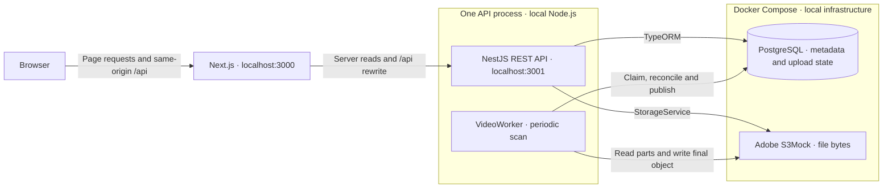
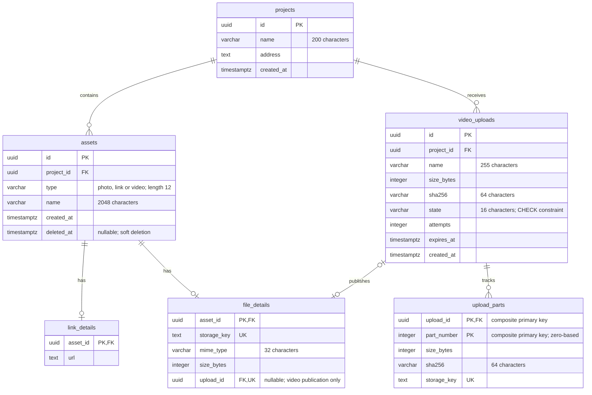

# Architecture and UI foundations

The design is sized for one take-home project: a small modular API and one coherent project view. The important boundaries are explicit in code; there is no generic service/repository hierarchy or new infrastructure to operate.

## System overview

Both apps run locally; Compose runs only PostgreSQL and S3Mock. The browser does not access the database or object storage directly. The worker runs inside the API process, using persisted upload state; it is not a separate service or a production queue. The current deployment model is one API instance.

## Frontend ownership

`features/project-assets` owns project composition, the QueryClient boundary and the initial server read. It fetches the mixed list once, validates the response and adapts photo metadata to the existing photo view contract. Each creation feature owns its input, mutation and recovery behavior. The public `/projects/:projectId/photos` URL remains compatible.

| Area | Responsibility |
| --- | --- |
| `project-assets.server.ts` | Server-only same-origin/internal API boundary; preserve not-found vs infrastructure errors |
| `project-assets-types.ts` | Runtime composition of explicit link/photo/video types; no silent malformed/unknown asset fallback |
| `links/` | URL validation, safe anchors and database-only link creation |
| `photos/` | Compatible photo upload, bounded preview and mutation reconciliation |
| `videos/video-types.ts` | Validated public video/status shapes and state predicates |
| `videos/video-api.ts` | Raw binary transport, whole-file hashing and at most two part workers |
| `videos/use-video-upload.ts` | Operation cancellation, polling, project-scoped recovery ID and status/list reconciliation |
| `videos/video-upload-task.tsx` / `video-card.tsx` | Incomplete work vs a published playable resource |

Query keys include project ID and resource type. Each page owns its QueryClient; server-user state is not stored in a module singleton. A confirmed write updates the relevant cache, with older queries canceled before deletion so stale responses cannot restore a card. Unknown outcomes block another write until an authoritative read succeeds. These semantics are feature-specific; one generic optimistic CRUD hook would hide meaningful differences.

Browser response types are runtime-validated, not simply cast from `response.json()`. Small guards shared by the parsers live in `lib/validation.ts`. Backend and frontend transport types are intentionally separate: no additional contracts package is needed for this scope, and HTTP validation remains necessary either way.

## Design system

[Figma design and architecture](https://www.figma.com/design/8C3K9vrJg9zXlVye9ist7t/Doc-home?node-id=66-282) is the single **Doc-home · Design and architecture** page, organized into five areas: tokens; components and recipes; responsive layouts; frontend behavior; backend and database. The original photo layouts are retained within the responsive area, alongside the current mixed-assets view and upload/recovery states in the frontend area. The separate old page has been removed.

Short English Design notes explain intent, module ownership and trade-offs for reviewers and AI-assisted development. They supplement the code and this document; they do not establish runtime behavior or replace validation.

[Panda configuration](../apps/web/panda.config.ts) is the source for semantic colors, typography, responsive names and component recipes.

| Layer | Examples / rule |
| --- | --- |
| Primitive tokens | Brand colors, Inter font, preset spacing/radius scale |
| Semantic roles | `bg.surface`, `bg.canvas`, `bg.media`, `bg.accentSubtle`, `fg.muted`, `action.primary`, `status.danger`, `focus.ring` |
| Typography | `pageTitle`, `heading`, `body`, `small`, `label` |
| Recipes | `button`, `textInput`, `assetSection`; runtime variants have their small necessary styles emitted |
| Components | `Button`, `TextInput`, `AssetSection`, `InlineFeedback` in `components/ui` |
| Feature composition | Photo upload, link form, video task/player; their domain state stays outside the UI primitives |

`AssetSection` gives Links, Photos and Videos the same heading/count/description structure, with surface/plain presentation. `Button` owns 44px minimum height, focus, disabled/hover and primary/secondary/danger roles. `TextInput` owns field dimensions/focus/disabled style. `InlineFeedback` consistently distinguishes alert/status semantics. Components do not accept an API client or hide network mutations.

Page padding is 20px mobile / 32px tablet and desktop. Breakpoints are called `mobile`, `tablet`, `desktop`; grid children use `minmax(0, 1fr)` and wrap long names/URLs. Native video uses a semantic media background, aspect-ratio container and `object-fit: contain`. No custom playback framework is necessary.

This is a project-sized foundation, not a claim to have delivered a complete multi-product component library. Figma remains an editable layout reference; no generated Code Connect or full library binding is claimed.

## Backend ownership

| Module | Owns | Does not own |
| --- | --- | --- |
| `assets` | Shared Asset/LinkDetail/FileDetail model, public mapping, mixed list and soft deletion | Uploading arbitrary client-chosen object keys |
| `photos` | Image boundary validation, original upload and bounded read-time resizing | Video processing or a second writable photo metadata table |
| `videos` | VideoUpload/UploadPart entities, immutable identity, session state and durable finalization | Universal codec support or production multi-instance coordination |
| `storage` | S3 object write, bounded buffer read, ranged stream, deletion and operation cancellation | Asset publication, image resizing or deletion policy |
| `http` | Request correlation and sanitized error envelope | Leaking SQL parameters, private keys or infrastructure errors to clients |

Storage operations are named for objects (`putObject`, `readObjectBuffer`, `openObjectStream`, `deleteObject`), because photos, chunks and final videos share them. Services receive StorageService directly instead of reaching through another service's internal fields. `UploadStatusResponse` and shared video mapping make the public boundary explicit; internal storage keys never belong to the DTO.

The shared Asset has an explicit type and one matching detail written atomically by its feature. SQL enforces scalar checks, keys and FKs; the application transaction enforces the type/detail relationship. FKs alone are not a polymorphic exclusivity constraint. Defensive response mapping rejects inconsistent metadata.

## Database relationships

The current model has six business tables. This diagram shows the relationships and selected columns; entities and SQL migrations define the full schema and constraints. `photos` is a retired table, and TypeORM migration history is not a business table.

- `assets` is the published resource identity. Links use `link_details`; photos and videos use `file_details`. Application transactions enforce the matching detail for each asset type; the diagram's optional detail relationships do not imply SQL alone enforces exclusivity.
- `video_uploads` and `upload_parts` describe work in progress. A session can exist without a published file. A published video has one unique upload association; photo file details have no upload association. Temporary part records can be cleaned up after completion.
- `storage_key` identifies an object in S3Mock, not bytes stored in PostgreSQL. All shown foreign keys use `ON DELETE RESTRICT`; soft deletion does not delete these rows or completed objects. The upload-related foreign keys are defined in migrations even where the entity only declares a scalar UUID column.

## Video invariants and decisions

| Decision | Reason and trade-off |
| --- | --- |
| 20 MiB, 5 MiB parts, two browser workers | Bounded assessment upload protocol; not a long-video scalability claim |
| Four active/reserved sessions, four receiving requests | Bounds admission and byte buffering for one API instance; temporary reservation is not S3 free capacity |
| PostgreSQL session/manifest | Progress and queued work survive process restart; in-memory flags are not a durable queue |
| Row locks around registration/state transitions | A late part cannot undo cancel/complete; browser byte reception and S3 writes happen outside SQL locks |
| Unique immutable temporary part keys | Simultaneous conflicting PUTs cannot overwrite confirmed bytes |
| Separate PROCESSING and READY | 100% confirmed transfer precedes checksum/container validation and publication |
| Unique upload association and final key | Retried completion cannot publish two assets; a deleted original cannot be recreated |
| Single periodic worker | Reuses the existing database and has a readable state machine; deployment is explicitly one instance |
| Bounded merge buffer | Acceptable at 20 MiB with one merge; includes copy/buffer overhead and is not constant memory |

`VideoWorker` reads as a sequence: scan → reconcile existing publication → claim an attempt → assemble/validate → write final object → publish atomically → retry or record failure. Attempts/deadlines/retry time are persisted. Each attempt uses a 60-second deadline, at most two attempts and a two-second transient retry delay; storage has its own ten-second operation budget. Bad hash/format is terminal. An earlier operation must settle before retry, and publication rechecks attempt/deadline under lock.

`video-policy.ts` names runtime limits with units. SQL migrations keep their historical scalar bounds: changing policy later requires an explicit schema/contract change, not editing already-applied migration SQL. API environment validation fails startup with setting names, never credential values.

## SQL and object storage are not one transaction

A part counts only after S3 write and a unique SQL manifest confirmation. While a session accepts parts, same-index/same-hash retries are safe; different bytes conflict. Processing and terminal states reject further parts. A storage timeout may still have written bytes, so its internal key is logged for reconciliation.

Finalization writes the complete object before the Asset/FileDetail/READY transaction. A lost COMMIT reply may mean success: retain the object, query the unique upload association on a later scan and avoid destructive compensation. A full inventory/sweeper is deferred. SQL publication is atomic; SQL and S3 together are not.

Soft deletion sets its first timestamp once and retains completed metadata, originals and upload association. Ordinary reads exclude tombstones. Canceled/expired/failed temporary parts have retryable cleanup. Restoring or purging a completed original would be separate product actions; neither is implemented.

## What verification proves

Unit/component tests cover parsing, request boundaries and state/UI outcomes. Disposable PostgreSQL/S3Mock tests exercise real HTTP/SQL/bytes with selected failure injection. Chrome E2E covers the complete mixed-asset flows and responsive layouts. [Delivery evidence](DELIVERY_VERIFICATION.md) records counts, commands and remaining gaps. This is separate from real AWS, other browsers, high-load behavior, user authorization or candidate understanding of AI-assisted work.
