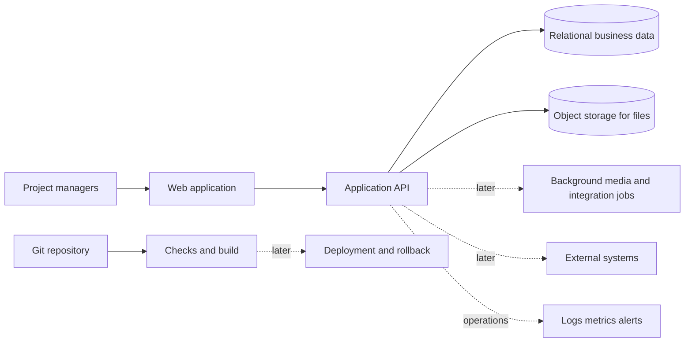

# Doc-home — product direction

This is a high-level direction, not a commitment to build the whole product. The assessment describes a project-detail view with links, documents, photos, videos and custom fields. Broader capabilities below are our proposals and would need user feedback and prioritisation.

The exact take-home scope is defined in [Project assets scope delivery plan](PROJECT_ASSETS_SCOPE_DELIVERY_PLAN.md). That document distinguishes the committed baseline from the approved next increments; this blueprint is background. Target mixed-asset contracts are in [Asset contracts](ASSET_CONTRACTS.md).

## Product purpose

Give project managers a shared workspace to understand a project and find the related material without switching between scattered systems.

## Capability areas / proposed Epics

| Epic | Possible capabilities | Relationship to this submission |
| --- | --- | --- |
| Project workspace | Project facts, ownership, status, dates; later project creation, editing and archive | A seeded project's name/address gives photos context |
| Related assets | Links, documents, photos and videos; upload, open, preview, list and delete | Links/Photos/Videos delivered locally; documents deferred |
| Custom information | Key-value fields; later templates and typed validation | Remaining brief capability, deferred |
| Collaboration | Comments, assignments, notifications and activity history | Future product proposal |
| Discovery and reporting | Search, filtering, saved views, exports and dashboards | Future product proposal |
| Integrations | Import/export, external APIs and webhooks | Future product proposal |
| Trust and operations | Authentication, project permissions, audit, backups, CI/CD and monitoring | Future product work; local checks and basic CI are included now |

## Possible long-term architecture

Start with one modular API. Add separate workers, search infrastructure or more services when a validated product need warrants them. The implemented Links/Photos/Videos slice uses PostgreSQL and local S3Mock with AWS SDK v3. Video sessions, bounded asynchronous processing and native playback use the same SQL/storage architecture; final delivery verification remains in increment 7. A production deployment would use private object storage such as S3 while business records keep their stable storage keys.

## Possible next increments after this submission

1. Complete the selected Links + Photos + Videos expansion and shared soft-deletion behavior, following the seven commit boundaries in the scope plan. Link creation and video processing remain type-specific.
2. After that selected expansion, consider document upload/download and custom fields. Clarify the brief's `XSL` document-format entry before implementing it.
3. Consider generated media previews, larger-video support and transcoding only when actual format/size/preview requirements justify them.
4. Expand project navigation and introduce identity, project permissions and protected file access before real customer use.
5. Replace the local S3 emulator with provisioned private object storage; verify IAM and real-provider behavior, then introduce backups, restore/purge policy and object reconciliation as required.
6. Extend checks with controlled deployment, production migration handling, rollback and monitoring. Collaboration, reporting and integrations follow validated demand.

These steps describe an evolution path, not a delivery schedule. No cloud provider, infrastructure tool, user-role model or performance target is assumed to be a company requirement.
