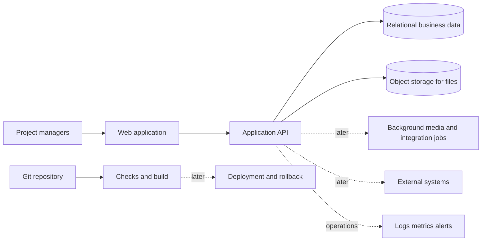

# Doc-home — product direction

This is a high-level direction, not a commitment to build the whole product. The assessment describes a project-detail view with links, documents, photos, videos and custom fields. Broader capabilities below are our proposals and would need user feedback and prioritisation.

The exact take-home scope is defined in [Project assets scope delivery plan](PROJECT_ASSETS_SCOPE_DELIVERY_PLAN.md). That document is authoritative for current implementation; this blueprint is background.

## Product purpose

Give project managers a shared workspace to understand a project and find the related material without switching between scattered systems.

## Capability areas / proposed Epics

| Epic | Possible capabilities | Relationship to this submission |
| --- | --- | --- |
| Project workspace | Project facts, ownership, status, dates; later project creation, editing and archive | A seeded project's name/address gives photos context |
| Related assets | Links, documents, photos and videos; upload, open, preview, list and delete | **Selected slice: JPG/PNG photos only** |
| Custom information | Key-value fields; later templates and typed validation | Remaining brief capability, deferred |
| Collaboration | Comments, assignments, notifications and activity history | Future product proposal |
| Discovery and reporting | Search, filtering, saved views, exports and dashboards | Future product proposal |
| Integrations | Import/export, external APIs and webhooks | Future product proposal |
| Trust and operations | Authentication, project permissions, audit, backups, CI/CD and monitoring | Future product work; local checks and basic CI are included now |

## Possible long-term architecture

Start with one modular API. Add separate workers, search infrastructure or more services when a validated product need warrants them. The delivered photo slice uses local S3Mock with AWS SDK v3; other asset types remain future work. A production deployment would use private object storage such as S3 while business records keep their stable storage keys.

## Possible next increments after this submission

1. Add external links to demonstrate a second asset type, then decide which listing/deletion behaviours deserve a common model.
2. Add document upload/download and custom fields to cover more of the brief. Clarify its `XSL` document-format entry before implementing it.
3. Add video playback and appropriate thumbnail generation when size, format and preview needs are clear.
4. Expand project navigation and introduce identity, project permissions and protected file access before real customer use.
5. Replace the local S3 emulator with provisioned private object storage; verify IAM and real-provider behaviour, then introduce versioning, cleanup jobs, backups and restore procedures as required.
6. Extend the basic CI with integration checks, controlled deployments, migration handling, rollback and monitoring. Collaboration, reporting and integrations follow validated demand.

These steps describe an evolution path, not a delivery schedule. No cloud provider, infrastructure tool, user-role model or performance target is assumed to be a company requirement.
