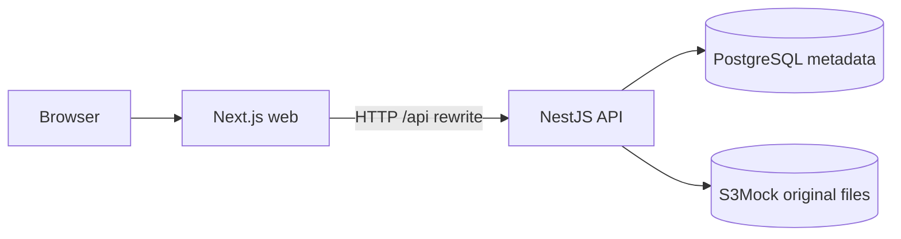

# Delivery scope — project photos

## Goal and boundary

Deliver one useful part of the assessment: a project manager can open a project's photo page, upload a JPG/PNG, view it and delete it. The project name/address gives the photos context.

The brief allows a meaningful subset. This photo-only slice demonstrates frontend/backend delivery, file handling and persistence. It does not cover every asset type or project-detail field.

| Included | Deferred |
| --- | --- |
| One seeded project; JPG/PNG upload, list, preview, original view and delete | Project creation/editing, links, documents, videos and custom fields |
| PostgreSQL metadata, S3-compatible file storage, migration and repeatable seed | A shared model spanning different asset types |
| Validation, loading/empty/error states, deletion confirmation and recovery feedback | Authentication, project permissions, audit and retention rules |
| Responsive page, focused tests and GitHub Actions CI | Batch uploads, pagination, cached thumbnails, committed E2E suite, CD and cloud deployment |

## Delivery breakdown

| Part | Delivered result |
| --- | --- |
| Foundation | Separate web/API apps in a pnpm workspace; environment validation, storage services and readiness check |
| Data | Project/Photo entities, explicit migration, constraints and stable-ID project seed |
| API | List, upload, original/resized read and delete; UUID/file validation and request-correlated errors |
| UI | Project context, photo count/grid, upload, original View, confirmed Delete and responsive/error states |
| Quality and delivery | Backend Jest, frontend Jest/RTL, local runtime/browser checks, path-aware CI and run instructions |

The [README](../README.md) is the entry point for setup, endpoint usage and recorded verification. CI is configured; its hosted result must be confirmed on GitHub before submission.

## Architecture and data

| Model | Stored fields and rules |
| --- | --- |
| Project | UUID, name, address, creation time; seeded without overwriting edits |
| Photo | UUID, project ID, original name, MIME type, byte size, storage key, creation time |

A project's photos are ordered by creation time and ID. SQL enforces the foreign key, unique storage keys, nonblank fields, positive size and allowed MIME types. Project deletion is restricted: a SQL cascade cannot clean up file objects. A composite `(project_id, created_at, id)` index supports the list query.

Object keys are generated from project/photo UUIDs, never chosen by uploaded filenames. The API returns public metadata and keeps storage keys private. Controllers handle HTTP; pipes/DTOs validate input; the photo service coordinates repositories and storage. No generic repository layer is added.

## User flow and failure handling

- The server loads the first page; a page-scoped TanStack Query cache handles subsequent refreshes without duplicating the hydration request.
- The browser checks selection for quick feedback; the API checks actual JPEG/PNG signatures and the inclusive 5 MiB limit.
- Upload writes bytes before metadata. A metadata-save failure attempts file cleanup while preserving the original error.
- Delete requires filename confirmation. The API scopes by project/photo IDs, deletes metadata first, then attempts object cleanup. Database failure preserves the bytes; cleanup failure is logged but still returns 204 because the record is already gone.
- The UI keeps a card until deletion is confirmed. Upload, delete and their reconciliation do not run over one another. Ambiguous outcomes require refresh, without automatic write retries; confirmed success followed by refresh failure is reported separately.
- Failed queries remain errors rather than empty lists. Failed previews show a placeholder while keeping the filename and actions.

There is no shared SQL/S3 transaction or durable cleanup job. Crashes, uncertain commit outcomes and failed compensation can leave inconsistent data or orphan files. Signature detection is not full decoding or malware scanning; buffered uploads and on-demand resizing are not designed for high concurrency. Project association is not authorization, and evidence-retention rules require business agreement before production use.

## Key decisions and trade-offs

| Decision | Reason | Cost / next step |
| --- | --- | --- |
| Photo-specific model | Keeps one complete workflow understandable | Does not demonstrate mixed asset behaviour; add Links before choosing common abstractions |
| Separate Next.js/NestJS apps in one repo | Clear web/API ownership with shared installation and history | Two local processes; more setup than a single app |
| TypeORM, explicit migrations, deterministic seed | Fits NestJS and makes schema changes reviewable | Entity and migration changes must stay aligned; no production migration pipeline |
| SQL metadata + local S3Mock | Exercises file storage without an AWS account | Extra container; emulator behaviour does not prove real S3 IAM/durability |
| Original files + bounded read-time resizing | Avoids a stored-variant lifecycle | Repeated CPU work; no transform/CDN cache or guaranteed byte-size reduction |
| Small DTO/types contract; no generated SDK/OpenAPI | Proportional to four endpoints | Manual types can drift; revisit code generation as consumers grow |
| Native deletion confirmation; serialized writes | Simple interaction and predictable recovery | Browser-controlled appearance and no parallel uploads/deletions |
| Focused unit/component CI; separate local runtime checks | Fast, repeatable checks without service provisioning | CI does not exercise real SQL, storage or a full browser flow |

## Design reference

[Editable Figma file](https://www.figma.com/design/8C3K9vrJg9zXlVye9ist7t/Doc-home-%C2%B7-Photo-management?node-id=3-5)

One page has empty/populated design states at desktop, tablet and mobile widths. It is a discussion reference, not a clickable prototype. A lightweight design made the flow concrete before implementation; Panda semantic colors, preset spacing/radii and one Button recipe keep the UI consistent without building a large component library.

| Breakpoint | Layout |
| --- | --- |
| `mobile`: 0rem | One column; stacked controls; 20px side padding |
| `tablet`: 48rem | Two columns; 32px side padding |
| `desktop`: 64rem | Three columns; up to 1152px usable content |

Previews: [desktop empty](images/photo-management-empty.png), [desktop populated](images/photo-management-desktop.png), [mobile populated](images/photo-management-mobile.png). These show illustrative content, not seeded photos or customer data. Example photo sources: [living room](https://images.unsplash.com/photo-1600210492486-724fe5c67fb0), [kitchen](https://images.unsplash.com/photo-1556912172-45b7abe8b7e1), [bedroom](https://images.unsplash.com/photo-1505693416388-ac5ce068fe85).

## Verification boundaries

The README records the latest test counts and commands. Backend unit tests cover handlers, service rules, validation, storage commands and failure recovery using I/O substitutes; frontend component tests cover pending/error/recovery interactions with mocked HTTP. These tests do not prove full route wiring, database constraints or provider permissions.

Separate local checks exercised real PostgreSQL/S3Mock and Chrome, including upload → list → view/resize → delete, Unicode filenames, API-restart persistence and responsive layouts. The temporary scripts are not a committed integration/E2E suite. Fresh-clone setup, final-feature persistence across storage-container restarts, cross-browser/full accessibility and load testing remain unverified.

## Next increments

1. Add external links to compare file-specific and shared behaviours: listing and deletion may share metadata, while only file assets need object cleanup. Define preview fallbacks per type.
2. Extend documents/custom fields after confirming validation and business rules; add authorization and retention/audit requirements before real customer use.
3. Add repeatable integration/E2E checks, then production storage, cleanup reconciliation, thumbnail caching and deployment as needed.

The [product blueprint](PRODUCT_BLUEPRINT.md) describes broader possibilities; they are not part of this delivery. Submit one PR from the working branch to `main` with scope, trade-offs, verification, actual effort and AI-assistance disclosure, adding the supplied reviewers.
