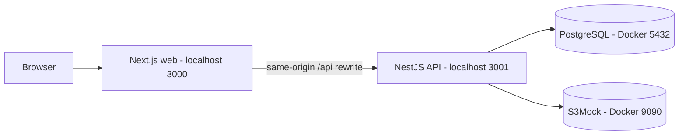
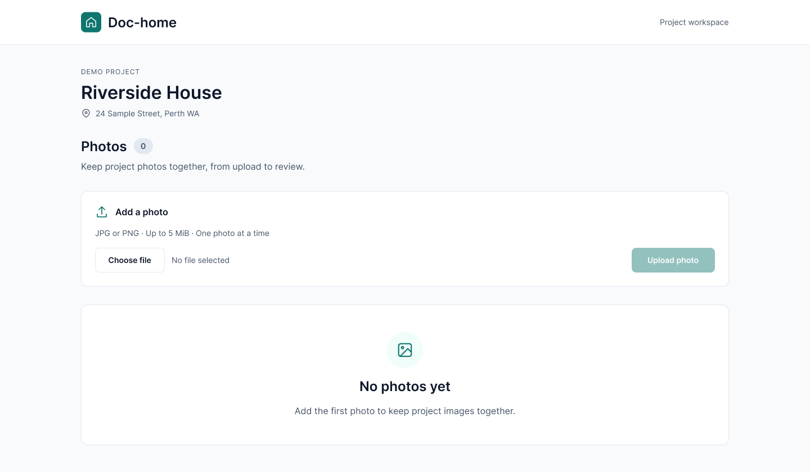
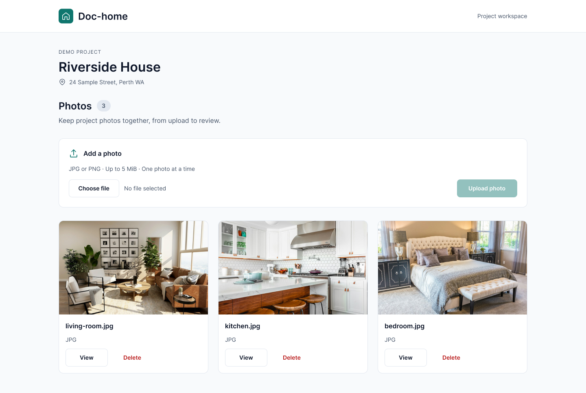
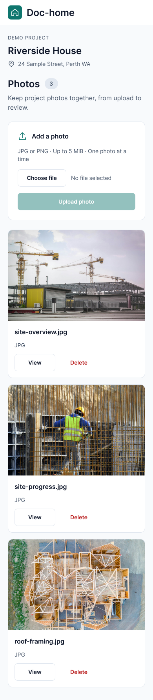

# Project assets scope — photo management

## 1. Delivery objective and current state

Deliver one complete workflow for a project manager: open a seeded project's photo page, upload a JPG/PNG, see it in the list, open the original image and delete it. Refreshing the page or restarting the local applications must preserve remaining photos and their records.

This is the selected slice of the broader **Related assets** Epic. The [product direction](PRODUCT_BLUEPRINT.md) explains possible expansion. This document defines current implementation tasks and acceptance criteria; it does not claim planned features are already delivered.

**Current state:** the pnpm workspace, Next.js/Panda frontend, NestJS API, PostgreSQL connection, validated environment configuration, S3 client/bucket health check and health route exist. Frontend/API run locally on ports 3000/3001; Docker runs PostgreSQL and S3Mock for local object storage. Lint, typecheck, build and local health/proxy checks passed during framework setup. Project/Photo entities, the initial migration, repeatable demo seed, shared database CLI options and feature modules now exist. The photo query endpoint, response types, UUID validation and basic request/error logs now exist. Upload and unit tests now exist. Original-image read and optional proportional w/h resizing are implemented. All four backend endpoints are implemented and verified; the web page now displays project context, empty/populated lists and original-image links; web upload/delete and frontend automated suites are **not implemented**; Jest/TypeScript unit tests now cover the four implemented photo handlers and related logic.

**Time boundary:** the original exercise allows one day. Our implementation target for the reduced feature is roughly 4–6 additional focused hours, with integration uncertainty. Planning and framework time already spent must also be disclosed. Estimates are not actual time records.

## 2. Scope boundary

| Included in this submission | Deferred |
| --- | --- |
| One repeatably seeded project with name/address | Project list, creation, editing and full detail workflow |
| Two business tables: Project and Photo | A generic asset hierarchy and unused tables |
| Single JPG/PNG upload, list, original-image view and delete | Links, PDF/documents, videos and custom fields |
| One page with upload control and photo list | Separate upload/search/detail screens, filters and pagination |
| Backend validation, clear UI states and failure cleanup | Bulk upload, pre-generated thumbnails and automatic retries |
| Local S3-compatible object storage and PostgreSQL persistence | Real AWS deployment, authentication and production infrastructure |
| Focused tests, checked startup steps and review notes | Full coverage, an interactive Figma prototype and CI/CD implementation |

A photo-only implementation demonstrates file handling; it does **not** demonstrate external-link handling or all shared behaviours across asset types. Explain that limit in the PR, and use the blueprint to discuss how a second type could be introduced.

## 3. Runtime and responsibility boundaries



- **Web:** React/TypeScript and Panda CSS render the page and request feedback. Interactive upload/delete controls call NestJS through `/api`; success triggers a new list request. Keep component and request helpers close to the photo feature.
- **API:** NestJS/TypeScript owns validation, project/photo association, database operations and file access. Use small controllers, a photo service and one S3 storage service. Add abstractions only when needed for this flow or meaningful failure tests.
- **Database:** PostgreSQL/TypeORM stores project facts and photo metadata. Keep `synchronize: false`; use an explicit migration and repeatable seed.
- **Files:** bytes go to the `doc-home-assets` bucket in local S3Mock using AWS SDK v3 and server-generated keys. PostgreSQL stores the keys. Keep bytes out of SQL, Git and Next.js `public`. S3Mock is a development emulator, not a production security boundary; AWS IAM/signature behaviour needs verification against real S3.
- **Tooling:** Node `>=24`, pnpm workspace, one lockfile and ESLint for both apps. Each app owns its specific configuration. No `.nvmrc`, app Dockerfiles, `.dockerignore`, Swagger or shared contracts package is needed for this scope.

The existing `/health` route checks PostgreSQL and bucket access; it is a framework readiness check, not one of the four business endpoints below. S3Mock creates the local bucket on startup and uses a persistent named volume. Do not auto-create production buckets in the API. The emulator accepts arbitrary bytes, but PDF business support remains deferred.

## 4. Scope A — data foundation

**Goal:** identify a project's photos and reproduce the schema on a clean database.

| Task | Implementation detail | Acceptance |
| --- | --- | --- |
| A1 Project entity | UUID `id`, `name`, `address`, `createdAt` | One known example project can be loaded |
| A2 Photo entity | UUID `id`, foreign key `projectId`, `originalName`, unique `storageKey`, `mimeType`, `sizeBytes`, `createdAt` | Metadata belongs to an existing project; positive file size and required fields enforced |
| A3 Migration | Create both tables, foreign key and composite index on `(projectId, createdAt, id)`; retain an explicit rollback | A clean database can apply the migration; rollback is checked on disposable data |
| A4 Seed | Use a stable demo project ID and document its page URL; insert only when absent | Re-running seed does not delete photos or overwrite user changes |

One Project has many Photos. `storageKey` locates bytes, for example `projects/<projectId>/photos/<generated-id>.jpg`; `originalName` is a display label, never a filesystem path. Store no signed URL or image binary in the table. TypeORM may maintain its own migration-history table in addition to these **two business tables**.

**Implemented:** TypeORM powers both NestJS and the database scripts. Feature modules register repositories; Entity metadata and migration SQL agree in the disposable-database check. The photo-to-project foreign key restricts project deletion because SQL cascades cannot clean up S3 objects. Basic nonblank, positive-size, MIME and unique-key constraints are enforced in SQL. Address remains display text; duplicate original filenames are allowed. File bytes, signed URLs and guessed photo fixtures are not seeded.

**Seed and schema evolution:** a handwritten, stable-ID fixture creates one demo project matching the design. No Prisma or Faker is added. `migration:run`, `migration:show`, `migration:revert` and `seed` scripts compile first and run against the configured database. Future schema changes get a new registered migration; do not edit shared/applied history. The initial `down` deletes tables, so rollback/reapply was checked only on disposable data. Production deployment and data-migration procedures remain future work.

**Checks completed:** fresh/repeated migration; schema metadata agreement; repeated seed preserving an edited project and an existing photo record; foreign-key/unique/check constraints; connection reinitialization; rollback/reapply on an isolated temporary database, which was then removed. Development migration and seed also ran successfully. At that data-foundation stage, photo HTTP handling had not been implemented. Query/upload verification is recorded below.

No project mutation or standalone project-detail API is needed. The photo-list response supplies the small project summary used by the page.

## 5. Scope B — query and response contract

**Endpoint:** `GET /projects/:projectId/photos`.

| Task | Implementation detail | Acceptance |
| --- | --- | --- |
| B1 Route validation | Validate UUID, then confirm project exists | Malformed ID gives 400; absent project gives 404 |
| B2 Query | Read only photos for that project, newest first with ID as a stable tie-breaker | No photos returns an empty list; query failure is an error, not an empty list |
| B3 Response mapping | Return a project summary and photo response objects; omit internal storage paths | Web can identify the project and render the list from one request |

Implemented query response shape (illustrative photo):

```json
{
  "project": { "id": "<uuid>", "name": "Demo project", "address": "Demo address" },
  "photos": [
    {
      "id": "<uuid>",
      "originalName": "kitchen.jpg",
      "mimeType": "image/jpeg",
      "sizeBytes": 245120,
      "createdAt": "2026-10-19T10:00:00.000Z"
    }
  ]
}
```

The values are illustrative, not seeded photo data. No content URL is returned yet. When the read route is implemented, the frontend can construct its URL from the project/photo IDs rather than coupling API responses to the web proxy prefix.

Use `PhotoResponseDto` and a small list-response shape for this HTTP contract; Entity classes describe persistence. TypeScript does not validate incoming HTTP by itself. Use ID pipes and file validation, with no empty input DTO just to create another file. A documented response shape is sufficient; no generated SDK or OpenAPI setup is required. For the initial four business endpoints, keep response DTOs in the API and matching response types/request helpers in one frontend photo API module. Do not import persistence entities or NestJS classes into the browser. Document the multipart field, response shapes and status codes in README as endpoints are implemented. API response types are implemented; frontend types/helpers remain planned.

**Query verification completed:** actual HTTP 200 (seeded, empty and populated), 400, 404; project isolation; descending createdAt/ID order; public fields/ISO timestamps; request-ID headers and JSON completion logs. Dedicated temporary records were removed. An isolated HTTP harness using the actual service/controller/filter and failing repository substitutes checked sanitized 500 responses for both query steps; no live database outage was induced. The check script remains outside the repository, and the frontend proxy/UI were not checked in this pass.

## 6. Scope C — upload and file read

**Upload, file read and optional proportional resizing are implemented.**

### Upload

**Endpoint:** `POST /projects/:projectId/photos`, one `multipart/form-data` field named `file`; success returns 201 and one photo response.

| Task | Implementation detail | Acceptance |
| --- | --- | --- |
| C1 Input checks | Validate project; require exactly one JPG/PNG; enforce request-parser size limit and content-type validation | Missing/multiple file input rejected; extension alone cannot approve a file |
| C2 Object storage | Generate a unique key and put bytes in the configured S3 bucket | Client filenames cannot select storage keys or overwrite another image |
| C3 Record creation | Save metadata after the file is written | New record appears in the project's list |
| C4 Failure compensation | If record creation fails, attempt to delete the written file; log cleanup failure without hiding the original error | Client receives an error; tests show cleanup was attempted |

**Implemented upload policy:** one JPEG/PNG up to **5 MiB** per request. This is our small-exercise choice, not a limit specified by the company. Validate content signatures using the chosen Nest file validator; this is not full image decoding, malware scanning or a production media pipeline.

**Upload checks completed:** the original 12 Node cases were migrated into Jest/TypeScript; unit cases cover signature/size/name validation, write order, missing project, put/save failures and cleanup failure preserving the original error. Real local HTTP checks verified upload/list and S3 object bytes/type plus rejection statuses. Temporary records/objects were removed; no live failure was induced. Files are buffered under the parser size cap; original filenames do not choose object keys. Compensation is best effort, and uncertain remote outcomes remain a limitation.

### Read original image

**Endpoint:** `GET /projects/:projectId/photos/:photoId/content`.

- Validate IDs and find the photo by **both** project and photo ID.
- Fetch its server-generated key from the configured bucket. Buffer at most 5 MiB before responding so storage-stream errors can return a proper HTTP error. Return the recorded JPEG/PNG Content-Type, length, inline disposition, nosniff and no-store headers. This bounded-buffer design is not a large-file streaming architecture.
- Wrong association, missing record or missing bytes returns 404; log a record/file mismatch for investigation.
- With no `w`/`h`, return the original bytes. With one parameter, scale proportionally to that maximum dimension; with both, fit inside the requested box. Preserve aspect ratio, do not crop/stretch/enlarge. For a 1200 × 800 source, `w=300` gives 300 × 200, `h=300` gives 450 × 300, and `w=300&h=300` gives 300 × 200.
- Parameters are optional positive decimal integers from 1–2048; invalid/repeated/unknown values return 400. Both output axes are capped at 2048 even when one is omitted. Sharp 0.35.5 applies EXIF orientation for resized output, limits source decoding to 40 million pixels and sets a 5-second processing timeout. Original bytes bypass transformation; resized output retains JPEG/PNG format, with default metadata removal/first-frame processing. Read-time resizing is a user-added scope increment. README examples and TypeScript comments explain the rules. No pre-generated variants, transformation cache or separate detail page. Only the original is stored.

**Read checks completed:** real HTTP original byte identity, PNG/JPEG, width/height/box fitting, no enlargement, 2048 global cap, EXIF orientation, headers, invalid-query 400, association/missing-record/missing-object 404, corrupt-image resize 500 and corresponding logs. Temporary fixtures were cleaned up. Pixel/time guard stress tests were not run. That endpoint commit did not add unit cases; the subsequent Jest/TypeScript testing commit now covers the three implemented endpoints together.

**Boundary:** the database and object storage do not share a transaction. Compensation is best effort. A process crash can still leave an orphan file; background reconciliation is deferred and must be named as a limitation.

## 7. Scope D — deletion

**Endpoint:** `DELETE /projects/:projectId/photos/:photoId`; success returns 204 with no response body.

| Task | Implementation detail | Acceptance |
| --- | --- | --- |
| D1 Resolve | Validate IDs and find a record belonging to the project | Cannot delete another project's photo; missing photo gives 404 |
| D2 Delete record | Delete the matched database record before removing bytes | Database failure leaves the file in place and returns an error |
| D3 File cleanup | Delete its stored object; an already-missing object counts as cleaned | Normal deletion removes both record and bytes |
| D4 Partial failure | If database deletion succeeded but file cleanup fails, log the key/error and return 204 | UI reflects removal; the known orphan-file risk is documented |

**Implemented and checked:** conditional deletion scopes both IDs; 204 is empty; repeated/wrong-project requests return 404; rows and objects are removed normally. Seven new Jest cases cover handler delegation, ordering, lookup/delete failures, a concurrent missing row and logged cleanup failure. The total backend suite is 118 cases.

This order prioritises a correct list after a committed database deletion. A failed cleanup needs a future reconciliation/retry job; it must not be described as guaranteed physical deletion. Repeating deletion after the record is gone can return 404. Do not build a generic retry or event system for this exercise.

## 8. Scope E — one frontend page

**First increment implemented:** project name/address, count, empty/populated lists, bounded preview and original View, preview fallback, loading/not-found/error routes, and 1/2/3-column responsive layout. Initial server fetch seeds a page-scoped TanStack Query cache; hydration does not duplicate the fetch. Browser requests use the existing /api rewrite. Upload form and Delete action are intentionally absent until their increments work. Shared API response decoding rejects malformed data rather than fabricating an empty list.

**Verification:** web typecheck/lint/production build passed. One-off real-browser checks (Playwright + installed Chrome) exercised empty/populated projects, original popup, failed preview, missing-project navigation and API-offline error/retry recovery at 1440/834/390/320 widths. Temporary fixtures/processes were cleaned up. No new frontend unit/E2E suite was committed; controlled slow-loading, Safari/Firefox and full accessibility audits remain unverified.

**Route:** `/projects/:projectId/photos`. `/` can redirect to the known seeded project's page after the seed exists; it must not become a project dashboard.

```text
Project name · Address
Photos

Choose a JPG/PNG, up to 5 MiB
[Choose file] [Upload]
Inline feedback

Photo list
[Preview]       [Preview]
filename.jpg    kitchen.png
[View] [Delete] [View] [Delete]
```

| Task | Implementation detail | Acceptance |
| --- | --- | --- |
| E1 Load | Fetch project/photo list on entry; show loading, empty, not-found or query error state | Query failure cannot look like an empty project; retry is available |
| E2 Upload | Label file input; show type/size guidance; early client checks; disable submission while pending | API remains authoritative; success clears the selected file and refreshes the list |
| E3 View | Render preview with useful alt text; open content URL in a new tab | A broken image shows a local placeholder without hiding its record |
| E4 Delete | Simple confirmation; disable the affected action during request; remove from displayed list only on confirmed success | Failure keeps the item visible and gives a retryable message |
| E5 Responsive UI | Readable small-screen layout, visible keyboard focus, wrapped names and clear buttons | No extra upload/search/detail screens or inactive controls |

Keep page/container, upload control and photo list understandable; do not create a component library. For a mutation timeout, tell the user the result could not be confirmed and refresh the list before inviting a retry. Do not automatically retry upload: the first attempt may already have saved successfully. If a successful mutation is followed by a failed refresh, distinguish “saved/deleted, list refresh failed” from “operation failed”.

### Design reference — display/view implemented, mutations pending

[Editable Figma file](https://www.figma.com/design/8C3K9vrJg9zXlVye9ist7t/Doc-home-%C2%B7-Photo-management?node-id=3-5)

One photo page has two designed states: empty and populated. Each is shown at Desktop (1440px), Tablet (834px) and Mobile (390px), for six frames total. The screens use editable text, SVG icons, component instances and bound variables. They are design references rather than a Figma clickable prototype. The web display/view states are now implemented; upload/delete controls follow in separate increments.

| Viewport | Intended implementation |
| --- | --- |
| `mobile` / 0rem | One photo column; 20px page gutter; file controls and upload action stack |
| `tablet` / 48rem (768px) | Two photo columns; 32px page gutter |
| `desktop` / 64rem (1024px) | Three photo columns; centered usable content capped at 1152px |

### Why design and frontend foundations belong together

I wanted something concrete to discuss before writing the feature. The design shows how the user moves through the page; the technical scope explains the data, boundaries and trade-offs. Together they give PMs, designers and engineers a shared reference, including people who do not need to read the implementation.

I also wanted to establish a few frontend rules early. If every component invents its own colors, padding and interaction states, the UI gradually becomes inconsistent. Shared tokens and a small Button component make those decisions reusable and easier to change together. My multimedia design background and AI-assisted Figma workflow made a lightweight design practical here.

The cost is upfront time and an obligation to keep the design and code aligned. I kept this to one page, two states, three responsive examples and the styling needed for that scope. It is not a full design system or clickable prototype, and a design does not replace technical validation or user feedback.

### Implemented frontend foundations

`apps/web/panda.config.ts` explicitly loads the official base/panda presets, retains their spacing and radius scales, and replaces the default breakpoint names with `mobile`, `tablet` and `desktop`. The names describe layout thresholds, not device detection. Figma frame widths are review examples rather than the breakpoints themselves.

The centered `page` size is 76rem (1216px) **including** side padding. At desktop size, 32px padding on each side leaves up to 1152px usable content; outer margins grow naturally on wider screens. Mobile uses 20px padding. Never hardcode the 144px gutter from the 1440px reference frame.

| Foundation | Small shared set |
| --- | --- |
| Colors | `bg.canvas`, `bg.surface`, `bg.subtle`, `fg`, `fg.muted`, `fg.onAccent`, `border`, `action.primary`, `action.primaryHover`, `status.success`, `status.danger`, `status.dangerSoft`, `focus.ring` |
| Palette | Preset neutral/status colors plus three custom brand values; semantic roles alias these values |
| Spacing | Prefer preset `2`, `3`, `4`, `6`, `8` rather than arbitrary per-component gaps |
| Radius | Preset `lg` (8px) for buttons, `xl` (12px) for panels/cards |
| Text | `pageTitle`, `heading`, `body`, `small`, `label`; Inter Variable is self-hosted via Fontsource |
| Button | One recipe and native React wrapper: `primary`, `secondary`, `danger`; minimum 44px height, hover, focus-visible and disabled states |

The reusable Button defaults to `type="button"`; form submission must be explicit. The scaffold's existing health link demonstrates the shared recipe without adding an inactive business control. PhotoCard, upload feedback components and the responsive photo grid remain feature work. No runtime UI component library was added. Figma buttons use an adapted Simple Design System base as a design asset only.

**Planned grid usage:**

```tsx
css({
  display: 'grid',
  gridTemplateColumns: {
    mobile: 'minmax(0, 1fr)',
    tablet: 'repeat(2, minmax(0, 1fr))',
    desktop: 'repeat(3, minmax(0, 1fr))',
  },
  gap: { mobile: '4', tablet: '6' },
})
```

References: [Panda presets](https://panda-css.com/docs/theming/presets), [responsive styling](https://panda-css.com/docs/styling/responsive-design), [recipes](https://panda-css.com/docs/recipes/overview).

Choose one file, then upload. Keep the action disabled until selection is valid; use an inline error/status region. Confirm deletion by filename and keep failed deletions visible. Error, pending and timeout behaviours are annotated in Figma and specified above; they are not additional full-page designs. At 320px, allow filename/guidance wrapping and avoid fixed-width form controls.

Project details, filenames and photo content are illustrative. Photo source assets: [living room](https://images.unsplash.com/photo-1600210492486-724fe5c67fb0), [kitchen](https://images.unsplash.com/photo-1556912172-45b7abe8b7e1), [bedroom](https://images.unsplash.com/photo-1505693416388-ac5ce068fe85). No actual customer data is used.

**Desktop — empty**



**Desktop — populated**



**Mobile — populated**



## 9. Scope F — errors, tests and review evidence

Use Nest HTTP exceptions for ordinary failures. A small global filter adds requestId and sanitizes unexpected failures; request middleware records status/duration with the same generated ID. Internal diagnostics keep error types and stack locations, omitting database error messages that can contain SQL parameters. Catch in business services only for recovery, file compensation or domain translation. Do not expose SQL errors, credentials or local paths in responses. Logs go to the console; external monitoring, distributed tracing, aborted-request tracking and durable log collection are deferred.

| Failure | Proposed response / UI behaviour |
| --- | --- |
| Malformed UUID or missing/unexpected file | 400; readable input error |
| Upload exceeds 5 MiB | 413; size guidance |
| Unsupported image content | 415; JPG/PNG guidance |
| Missing project/photo or mismatched association | 404; clear not-found state |
| Unexpected database/storage failure | 500; generic user message and internal log |
| Query request fails | Error plus retry, never a fabricated empty list |
| Photo image cannot load | Per-image placeholder; keep filename/actions available |

Set upload-validator status codes explicitly where defaults differ. The API and UI must agree on this small contract.

### Focused verification

| Check | Method | Why |
| --- | --- | --- |
| Upload → list → read → delete | API integration test with real PostgreSQL and an isolated S3Mock test bucket | Covers the business loop and actual persistence |
| Empty list, nonexistent project and invalid ID | API integration cases | Distinguishes valid empty data from errors |
| Missing file, bad image type and oversized upload | API cases through the upload boundary | Exercises real request validation |
| Wrong-project read/delete | API integration with a second test fixture project | Enforces association even though UI shows one demo project |
| Metadata save fails after bytes written | Service unit test with simulated dependency failure | Confirms compensating cleanup is attempted |
| Record delete fails / file cleanup fails | Service unit tests | Confirms the chosen deletion ordering and logging |
| Repeated seed, migration and app restart | Disposable-data checks and manual walkthrough | Confirms reproducible startup and remaining-data persistence |
| Upload/delete pending, error and narrow viewport | Manual browser walkthrough | Checks the one page as a user experiences it |

Backend unit tests are now consolidated in Jest with TypeScript, before continuing the UI. The transitional Node-runner upload cases have been migrated and the old runner entry removed. Nine suites contain 118 passing cases for the three photo handlers, service rules, validation, SDK storage boundaries, errors/logging, environment and health. Specs use repository/storage substitutes and AWS command mocks without Docker or real HTTP listeners. Frontend component tests will use React Testing Library and browser flows Playwright when the UI exists. Record exact commands and actual results, including failed or unrun checks, for the final PR verification section; personal working notes stay outside the repository.

**Latest backend recheck:** the three implemented query/upload/read endpoints passed real local PostgreSQL/S3Mock checks again, including API-process restart with preserved records/bytes. Jest 9 suites/118 cases and API typecheck/lint/build passed. Current migration was applied. Dedicated check fixtures were removed, existing data and storage containers preserved. Deletion has now passed the complete upload/query/read/delete check. The selected backend loop is complete; frontend/full delivery remain incomplete. README now includes the manual startup/upload/query/read/restart walkthrough. This did not verify a fresh installation, storage-container restart, deletion or UI.

### Completion checklist

- [ ] Fresh setup instructions work with local web/API and Docker PostgreSQL/S3Mock.
- [x] Migration and repeatable seed create the demo project without clearing added data.
- [ ] One page supports upload, list, original-image view and delete.
- [ ] JPG/PNG and size rules are enforced by the API; IDs and project association are checked.
- [ ] App and pinned storage-service restart preserve remaining metadata and objects.
- [ ] Expected errors and mutation ambiguity produce truthful UI feedback.
- [ ] Focused tests and the manual walkthrough have recorded results.
- [ ] README/PR describe actual delivery, omissions, file-cleanup limitation, actual time and AI use.

## 10. Work order and commit organisation

**The initial work is organised into the agreed three review commits:**

1. **Docs:** Markdown scope, concise blueprint, agent guidance, startup README. Keep statements of planned work clearly labelled.
2. **Setup:** root pnpm scripts/workspace, Node `>=24` requirement, ignore rules and PostgreSQL/S3Mock Compose configuration. Application commands become available with the next framework commit.
3. **Frontend/backend framework:** separate `apps/web` and `apps/api`, app dependency manifests, app-specific configurations and example API environment. Put the generated root lockfile with this commit because it depends on those manifests. Attach the framework verification note here.

These are staging boundaries for a transparent local history cleanup authorised by the user, not a claim that the project was originally created in that order. The original history is preserved on a backup branch. Framework checks were run before regrouping; final source contents are compared against the saved working tree. Remote pushes remain user-controlled.

**After those three commits**, add the lightweight design reference, then advance one small implemented result at a time:

| Sequence | Work scopes | Outcome to commit |
| --- | --- | --- |
| 4 | E design + theme | Figma reference/previews, shared Panda theme, named breakpoints and reusable Button; no photo feature implementation |
| 5 | A | Project/Photo schema, migration and repeatable seed |
| 6 | B | Project photo-list API and response contract |
| 7 | C upload | Validated upload, metadata and compensation |
| 8 | C read | Original-image content route and association checks |
| 9 | E load/view | One working query/list/preview page |
| 10 | E upload | Upload control and refresh/error behaviour |
| 11 | D + E delete | Delete API and UI with failure handling |
| 12 | F | Final cross-flow verification, remaining fixes and delivery-document consolidation |

Functional commits include concise descriptions explaining the change and reason. The user chose a separate Jest/TypeScript testing commit after query/upload/read; it is now implemented. Continue using Jest and TypeScript for subsequent backend unit cases. Keep personal preparation notes outside the repository; summarise trade-offs, checks and next steps in the final PR. The list may be adjusted for genuinely small or tightly coupled changes; it is not a target commit count.

The original exercise permits one representative subset, but the company's agreement to this **photo-only** scope and the exact deadline still need confirmation. Draft a short scope/deadline message for the user to review if needed; do not contact the company without explicit authorisation. Submit one PR from the working branch to `main`, with the supplied reviewer usernames, when ready.

## 11. Explicit trade-offs and next increments

| Choice now | Benefit | Cost / later action |
| --- | --- | --- |
| Photos only, specific Photo model | Small and explainable end-to-end feature | Does not demonstrate mixed asset types; add links/documents and evolve a shared model when justified |
| One seeded project, two business tables | Real association with minimal project workflow | More project flows are future work |
| Explicit DTOs/types and a short HTTP contract; defer OpenAPI/Swagger and generated clients | Keep setup proportional to four business endpoints and focus on the working flow | Manual frontend/backend types can drift; update both sides and verify the contract with focused API checks. Revisit OpenAPI plus type generation when endpoints, consumers or parallel development increase |
| Local S3 emulator with AWS SDK | Exercises object APIs without a cloud account; keeps bytes separate from SQL | Extra container/dependency; emulator does not prove AWS permissions or production durability |
| Store originals; optional read-time resizing; no pagination | No stored variant lifecycle; caller can request bounded dimensions | Per-request CPU/latency; validate decoding/output limits, and add caching/pagination as usage grows |
| Web/API local, Docker PostgreSQL and S3Mock | Quick app iteration with reproducible storage services | Reviewer needs Node/pnpm and Docker; emulator version stays pinned |
| No auth or CI implementation | Protects the small time box | Access control and deployment quality work precede real customer use |
| Best-effort file cleanup | Makes partial failures explicit without a job system | Orphans remain possible; add reconciliation when needed |

At the end of the exercise, explain the next steps from the blueprint rather than implying they were delivered. Do not expand this scope to make the code look more elaborate.
